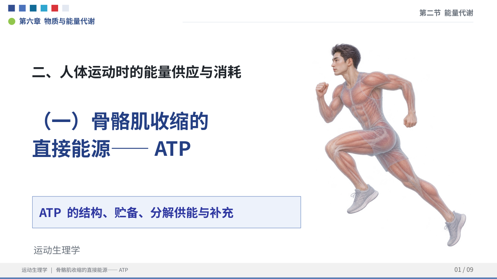

# 骨骼肌收缩的直接能源——ATP

运动生理学课堂课件与逐字讲稿。当前版本：运动人体封面与逐步动画版（2026-11-10），参考UCI课程，9页PPT、蓝白模板、左图右解，含演讲者备注。

## 封面更新

封面右侧新增原创淡色跑步姿态人体图，左侧为章节与课题；保留蓝白模板。人体图随课题在第一次单击时同时淡入，页数仍为9页、点击构建仍为42次。



## 动画播放

- [下载动画PPT](https://raw.githubusercontent.com/TaoXyjammy/ATPLecture/main/ATP_Lecture_Animated.pptx)
- 9页、42次单击构建。进入WPS演示或PowerPoint的幻灯片放映后，用鼠标单击、空格或方向右键推进。
- 文字与反应式按讲稿顺序淡入，第6页横桥循环按①到⑥逐步揭示并高亮当前步骤。
- 没有自动翻页、音频或宏。第6页是分步图解，不是连续分子运动模拟。
- [逐页播放说明](PLAYBACK_GUIDE.md)。配套讲稿和演讲者备注均加入了动画提示。
- PDF是完整静态页面预览，不包含PPT动画。

## 本次更新

- 第2页：左侧说明ATP结构与作用，右侧新增骨骼肌—肌束—肌纤维—肌原纤维结构图。
- 第4页：左右分栏，左讲ATP贮备，右讲ATP水解供能。
- 第6页：六步横桥循环详图，显示ATP结合、解离、水解储能、重新结合、动力冲程、ADP释放。
- 讲稿与演讲者备注同步修订，仍为9页。
- 新增示意图以高清图片嵌入PPT；正文与反应式保持可编辑。

## HTTPS直接下载

| 内容 | 下载链接 |
|---|---|
| 可编辑PPT | [ATP_Lecture_UCI_Reference.pptx](https://raw.githubusercontent.com/TaoXyjammy/ATPLecture/main/ATP_Lecture_UCI_Reference.pptx) |
| PPT的PDF预览 | [ATP_Lecture_UCI_Reference.pdf](https://raw.githubusercontent.com/TaoXyjammy/ATPLecture/main/ATP_Lecture_UCI_Reference.pdf) |
| Word逐字讲稿 | [ATP_Lecture_Notes.docx](https://raw.githubusercontent.com/TaoXyjammy/ATPLecture/main/ATP_Lecture_Notes.docx) |
| 讲稿PDF | [ATP_Lecture_Notes.pdf](https://raw.githubusercontent.com/TaoXyjammy/ATPLecture/main/ATP_Lecture_Notes.pdf) |

## 课程范围

第六章第二节“能量代谢” → 二、人体运动时的能量供应与消耗 →（一）骨骼肌收缩的直接能源——ATP。

包括ATP作用与结构、生成、贮备与水解、横桥循环与钙离子回收、磷酸肌酸补充与恢复、ATP稳态。

## 参考与图示

- [UCI E183 Lecture 11](https://madaley.github.io/E183_ExercisePhysiology/week05/lecture11-muscle-cellular)
- [课程参考仓库](https://github.com/MADaley/E183_ExercisePhysiology)
- [OpenStax Anatomy and Physiology 2e §10.3](https://openstax.org/books/anatomy-and-physiology-2e/pages/10-3-muscle-fiber-contraction-and-relaxation)
- 用户提供的教材第175—176页与讲稿。

UCI资料仅用于科学概念和讲解联系的参考；本仓库不包含其原始或修改后的课件图片，也非其课件的逐页翻译。配图含本次原创流程图及依据用户教材制作的教学简化图，不表示UCI或授课教师认可本资料。

## 完整性校验

下载全部文件和 `SHA256SUMS.txt` 后，可运行：

```sh
sha256sum -c SHA256SUMS.txt
```
